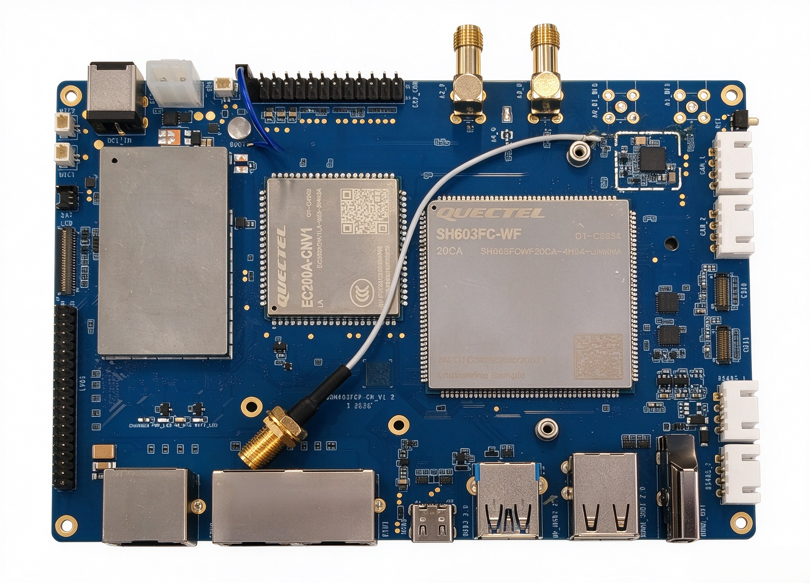
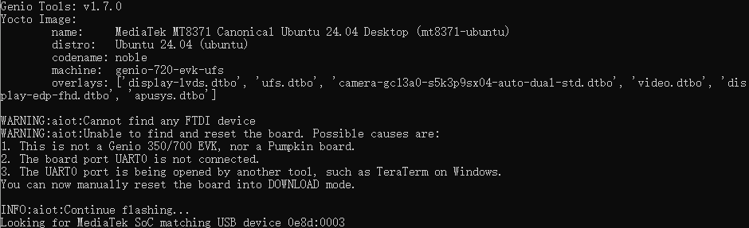
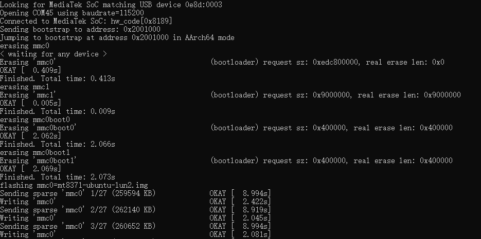
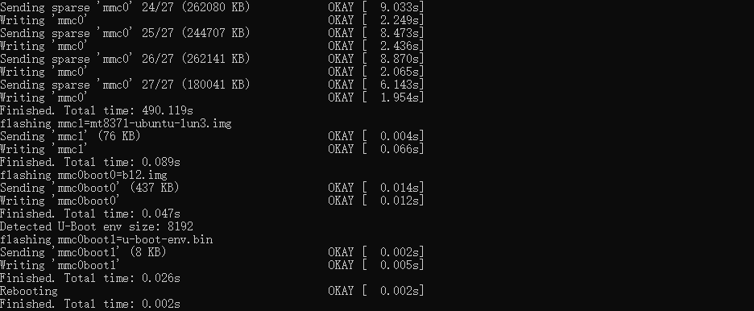

# QSM603FCP EVK Linux 开发指南

 []() []() []() 

> **适用硬件：** Quectel QSM603FCP EVK
>
> **适用对象：** Linux BSP / 驱动 / 应用开发人员
>
> **核心内容：** 快速上手 · SDK 编译 · 镜像烧录 · 功能验证

# 目录

- [文档概览](#文档概览)
- [快速上手](#快速上手)
  - [开发板介绍](#开发板介绍)
  - [开发准备](#开发准备)
  - [环境搭建](#环境搭建)
  - [镜像编译](#镜像编译)
  - [镜像烧录与系统启动](#镜像烧录与系统启动)
- [专项开发文档](#专项开发文档)
- [FAQ](#FAQ)
- [修订记录](#修订记录)

---

# 文档概览

本文档介绍 **QSM603FCP EVK** 的基本信息、开发环境搭建、镜像编译与烧录、主要功能及相关开发文档，为开发人员进行 QSM603FCP Linux BSP 开发及功能验证提供参考。

> [!TIP]
>
> 开发板已预烧录系统镜像，可直接上电使用。预烧录镜像用于基本功能体验，具体功能支持及软件版本请以当前发布的 SDK 为准。

### 开始之前

首次使用 QSM603FCP EVK 时，建议按以下顺序操作：

**准备硬件 → 准备开发环境 → 获取 SDK → 搭建环境 → 编译镜像 → 烧录镜像 → 启动系统 → 验证功能**

> [!TIP]
>
> 若仅需快速体验开发板，可跳过编译步骤，直接使用预烧录镜像完成上电和系统启动。

# 快速上手

本章节用于完成 QSM603FCP EVK 的首次使用。完成后，开发板应能够正常启动 Ubuntu 系统，并可通过调试串口查看系统启动日志。

> [!NOTE]
>
> 本章节仅介绍基本操作流程。各功能的详细配置、开发及调试方法，请参考后续章节及对应专项开发文档。

## 开发板介绍

### 基本信息

QSM603FCP EVK 是基于 MTK MT8371 应用处理器设计的评估开发平台，用于验证 Linux BSP、显示、多媒体、无线连接、工业控制及边缘 AI 应用开发。

开发板集成 Quectel QSM603FCP 核心模组，支持 Wi-Fi、Bluetooth、以太网、USB、HDMI/LVDS 显示等外设接口，可满足工业 HMI、智能网关、边缘计算、视频分析及 IoT 终端等应用场景的开发需求。

套件预览图：



### 主要特性

| 类别 | 特性 |
| --- | --- |
| 处理器 | MTK MT8371 |
| 操作系统 | Ubuntu 24.04 |
| 无线 | Wi-Fi + Bluetooth |
| 有线网络 | 1 x Gigabit Ethernet + 2 x 100 Mbps Ethernet |
| 显示 | HDMI、LVDS |
| USB | USB Host / Device |
| 存储 | UFS Flash |
| 工业接口 | CAN FD |
| 音频 | Audio Codec |

> [!NOTE]
>
> 上表为主要特性概览，接口能力及软件支持情况请以当前发布的 SDK 为准。

## 开发准备

### 硬件准备

| 设备 | 数量 | 用途 | 必需 |
| --- | ---: | --- | :---: |
| QSM603FCP-KIT 套件 | 1 | QSM603FCP EVK 开发及功能验证 | 是 |
| 开发主机 | 1 | SDK 编译、镜像烧录及开发调试 | 是 |
| 网线 | 可选 | 以太网连接及网络功能测试 | 否 |
| SIM 卡 | 可选 | 蜂窝拨号上网及通话验证 | 否 |

### 软件准备

QSM603 系列 Linux BSP 开发主要需要以下软件资源：

- Linux 开发环境
- SDK 开发包
- Docker 构建镜像
- 镜像烧录工具

#### Linux 开发环境

推荐使用 **Ubuntu 22.04 LTS 及以上版本**。

#### SDK 开发包

SDK 包包含 QSM603 系列平台 Linux BSP 开发所需的源码、构建脚本及配置文件，通过 Quectel Git 仓库获取，具体步骤参见 [环境搭建](#环境搭建)。

| 资源 | 获取方式 | 是否必需 |
| --- | --- | :---: |
| QSM603FCP SDK 源码 | Quectel Git 仓库（SSH，分支 `QSM603FCP_rl`） | 是 |
| Docker 构建镜像 `mt8371-ubuntu-build-24.04.tar` | 联系 Quectel 获取 | 是 |

#### 镜像烧录工具

| 开发环境 | 推荐方式 |
| --- | --- |
| Windows | 使用 MTK Genio 烧录工具（genio-tools） |

## 环境搭建

### 获取 SDK

**步骤 1：创建工作目录**

```bash
mkdir -p ~/MTK-MT8371
```

**步骤 2：获取 SDK 源码**

<span style="color:red"><b>注意：后续提供正式 SDK 下载方式后，需按实际情况调整本节内容。</b></span>

先访问 https://git-master.quectel.com/-/profile/keys 添加 SSH Keys，再执行以下命令克隆 SDK：

```bash
cd ~/MTK-MT8371/
git clone -b QSM603FCP_rl --depth 1 ssh://git@git-master.quectel.com:8407/smart_new/mt8371_ubuntu_bu01_v25.1.1/mt8371_ubuntu_bu01_v25.1.1.git
```

**步骤 3：导入 Docker 构建镜像**

Docker 镜像 `mt8371-ubuntu-build-24.04.tar` 请联系 Quectel 获取，导入命令如下：

```bash
docker load -i mt8371-ubuntu-build-24.04.tar
```

> [!NOTE]
>
> 导入完成后，可通过 `docker images` 确认本地已存在镜像 `mt8371-ubuntu-build:24.04`。

## 镜像编译

> [!NOTE]
>
> 本章节仅介绍基本镜像编译流程。

### 编译完整镜像

**步骤 1：进入工作目录**

```bash
cd ~/MTK-MT8371/mt8371_ubuntu_bu01_v25.1.1
```

**步骤 2：进入 Docker 环境**

```bash
IMAGE_NAME=mt8371-ubuntu-build:24.04 LOCAL_USER=user LOCAL_UID=1000 LOCAL_GID=1000 ./scripts/docker.sh shell
```

**步骤 3：执行编译命令**

> [!NOTE]
>
> 以下命令需要在 Docker 环境中执行。

```bash
source build.sh
build all
```

### 查看编译产物

镜像产物位于：

```text
~/MTK-MT8371/mt8371_ubuntu_bu01_v25.1.1/bin/mtk-mt8371/
```

查看编译产物：

```bash
ls ~/MTK-MT8371/mt8371_ubuntu_bu01_v25.1.1/bin/mtk-mt8371/
```

> [!NOTE]
>
> 该目录包含 BL2、FIP、LK、U-Boot、分区表及 Ubuntu 根文件系统等烧录相关镜像。实际用于烧录的镜像文件请以当前 SDK 版本为准。

## 镜像烧录与系统启动

> [!CAUTION]
>
> 烧录会覆盖板卡现有镜像，操作前请确认已备份必要数据。

### Windows 环境烧录

#### 步骤 1：安装烧录工具

1. 从仓库 `tools/`目录下，获取`android_usb_110_64_1228.exe` 并执行安装（USB 驱动）。
2. 从 https://www.python.org/downloads/ 下载并安装 Python 3.12.x。
3. 安装 MTK 烧录工具 genio-tools：

```bash
py -3.12 -m pip uninstall -y genio-tools
# 若首次安装失败，可重复执行一次
py -3.12 -m pip install genio-tools==1.7.0
```

> [!NOTE]
>
> `genio-flash.exe` 默认安装于 Python 安装目录的 `Scripts` 子目录，例如 `C:\Users\<用户名>\AppData\Local\Programs\Python\Python312\Scripts\genio-flash.exe`，请根据实际环境调整路径。

#### 步骤 2：准备烧录文件

将编译产物目录 `~/MTK-MT8371/mt8371_ubuntu_bu01_v25.1.1/bin/mtk-mt8371/` 下的文件复制到 Windows 主机，例如复制到 `D:\mtk-mt8371`。

#### 步骤 3：执行烧录命令

在 PowerShell / CMD 中进入烧录文件所在目录，执行：

```bash
C:\Users\<用户名>\AppData\Local\Programs\Python\Python312\Scripts\genio-flash.exe
```

#### 步骤 4：设置设备进入下载模式

使用 USB 线将 PC 与 EVB 的type C接口相连，将 EVB 板上丝印为 `BOOT` 的触点短接到 GND。然后给板子上电。烧写工具会自动发现设备并开始烧写。


##### 烧写进度1：等待设备接入


##### 烧写进度2：设备接入后


##### 烧写进度3：烧写结束



> [!NOTE]
>
> 烧录过程约需 5 分钟，不同 PC 的烧录速度可能略有差异。当工具日志正确识别到 COM 口并出现 `flashing` 等关键字时，表示已进入烧录状态。

#### 步骤 5：启动系统

- 烧录开始后即可断开 `BOOT` 触点与 GND 的连接；烧录完成后板卡系统会自动启动。若未正常启动，可重新给板卡上电。
- 若已接入 1920×1080 分辨率的 HDMI 屏幕，屏幕将显示 Ubuntu 24.04 桌面。
- 可通过 Type-C 接口与 PC 连接，并使用 `adb` 工具登录板卡系统，以判断系统启动状态。
- 电源接口旁的 26 pin 接口中，Pin 15 为 TX、Pin 17 为 RX、Pin 19 为 GND，电压域3.3V，波特率为 921600。也可通过该接口查看系统启动日志，判断板卡系统的启动状态。

# 专项开发文档

QSM603FCP EVK 提供显示、摄像头、音频、网络及无线通信等功能。各功能的详细配置及使用方法请参考对应专项开发文档。

| 类别 | 文档 | 说明 |
| --- | --- | --- |
| 显示 | 待补充 | HDMI、LVDS 显示配置及调试 |
| 音频 | 待补充 | Audio Codec 及音频功能测试 |
| 网络 | 待补充 | 以太网及网络功能验证 |
| 无线 | 待补充 | Wi-Fi 与 Bluetooth 功能验证 |

> [!NOTE]
>
> 专项开发文档将随 SDK 发布同步提供，如需获取请联系 Quectel。

# FAQ

参考文档：[FAQ](./FAQ.md)
